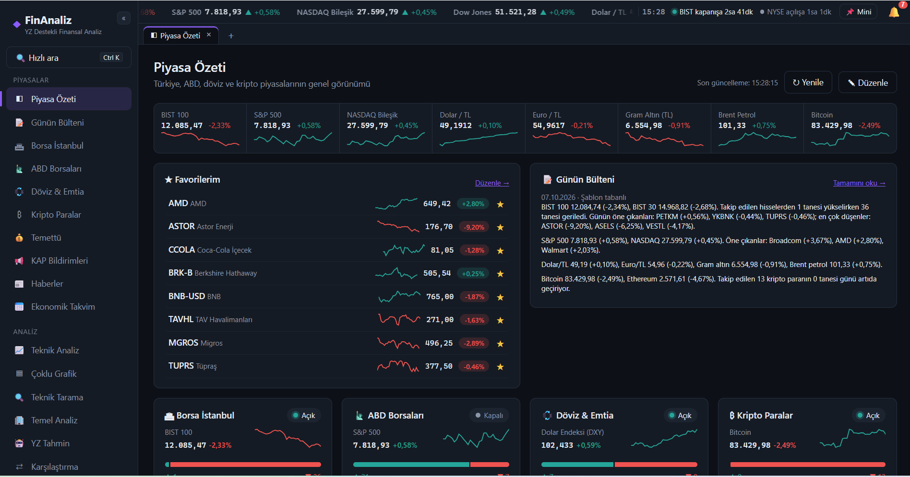
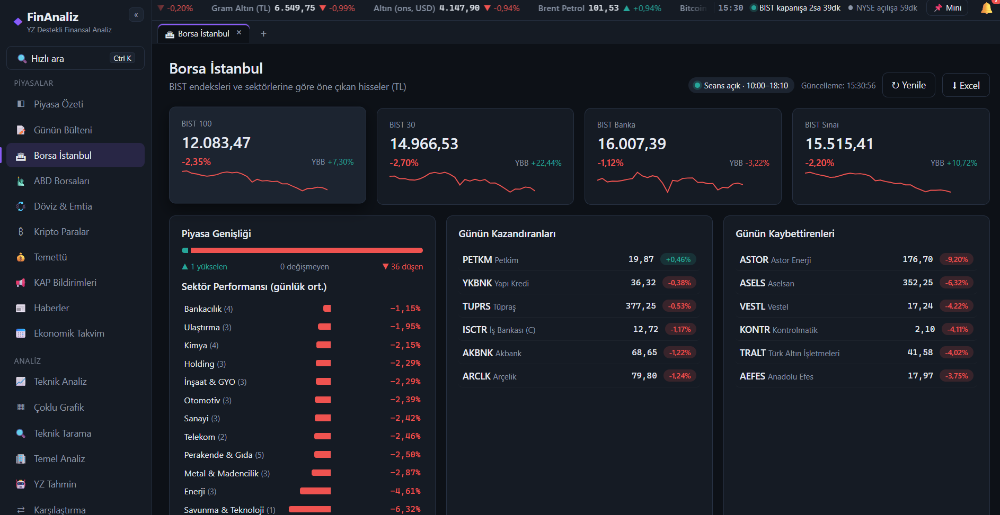
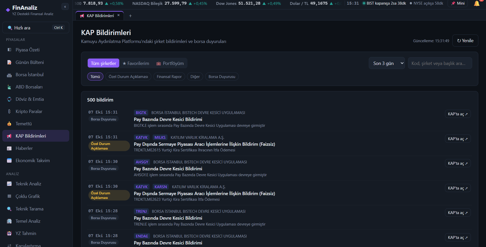

# TradeMetrix


> Proje adı: **Borsa, Döviz ve Kripto Piyasaları için Yapay Zekâ Destekli Finansal Analiz Platformu** (eski çalışma adı: FinAnaliz)

**Borsa, Döviz ve Kripto Piyasaları için Yapay Zekâ Destekli Finansal Analiz Platformu**
Bitirme projesi, yerel masaüstü sürümü. Mimari, ileride web sürümüne geçilebilecek şekilde istemci–sunucu olarak kuruldu.

## Ekran Görüntüleri

**Piyasa Özeti:** Türkiye, ABD, döviz ve kripto piyasalarının genel görünümü, favoriler ve günün bülteni


**Borsa İstanbul:** BIST endeksleri, piyasa genişliği, sektör performansı, günün kazandıranları ve kaybettirenleri


**KAP Bildirimleri:** Kamuyu Aydınlatma Platformu bildirimleri; favori ve portföy hisselerine göre filtreleme


## Çalıştırma

**Uygulama (exe):** `Uygulama\TradeMetrix.exe` dosyasını açın. Python veya Node.js kurulu olması gerekmez. Uygulama kendi Windows penceresinde (WebView2) açılır. Kullanıcı verileri `%APPDATA%\FinAnaliz` klasöründe tutulur. `Uygulama` klasörü bir bütündür; exe'yi tek başına başka yere taşımayın. Masaüstüne kısayol oluşturmak için exe'ye sağ tıklayıp *Gönder → Masaüstü (kısayol oluştur)* seçeneğini kullanın.

**Kod değişikliğinden sonra exe'yi yeniden oluşturmak:** `exe_olustur.bat` dosyasını çalıştırın. Bu betik arayüzü derler, PyInstaller ile exe'yi üretir ve `Uygulama` klasörünü günceller.

**Kaynak koddan çalıştırmak:** `baslat.bat`. Bu yol Python 3.11+ ve Node.js 18+ gerektirir.

Geliştirme modunda çalıştırmak için:

```
python backend/run_desktop.py --no-window   # API: http://127.0.0.1:8765  (Swagger: /docs)
cd frontend && npm run dev                  # arayüz: http://localhost:5173 (canlı yenileme)
```

## Mimari

| Katman | Teknoloji | Dosyalar |
|---|---|---|
| Arayüz | React + TypeScript (Vite), TradingView Lightweight Charts | `frontend/src/` |
| Yerel REST API | FastAPI (Python) | `backend/app/main.py` |
| Veri toplama | yfinance (BIST `.IS`, ABD, döviz `=X`, kripto `-USD`) | `backend/app/market.py` |
| Teknik analiz | SMA, EMA, RSI, MACD, Bollinger, ATR | `backend/app/indicators.py` |
| Tahmin (YZ) | scikit-learn: Lojistik/Ridge, Rastgele Orman, Gradyan Artırma, MLP; statsmodels: ARIMA (LSTM isteğe bağlı, PyTorch kuruluysa) | `backend/app/ml.py`, `backend/app/seq_models.py` |
| Formasyonlar | Mum formasyonları, destek/direnç, çoklu zaman dilimi | `backend/app/patterns.py` |
| Tarama | Teknik tarama (screener) | `backend/app/screener.py` |
| Haberler | Google Haberler RSS + LLM / sözlük tabanlı duygu analizi | `backend/app/news.py` |
| Ekonomik takvim | ForexFactory haftalık takvim | `backend/app/econ.py` |
| Bülten | Günlük piyasa bülteni (LLM veya şablon) | `backend/app/bulletin.py` |
| Portföy | İşlem geçmişi, ortalama maliyet, temettü, hedef dağılım, danışman | `backend/app/portfolio.py` |
| Raporlar | Excel (openpyxl), PDF (reportlab) | `backend/app/export.py` |
| Strateji testi | SMA kesişimi, RSI, MACD, Bollinger, Al-Tut | `backend/app/backtest.py` |
| LLM asistanı | Anthropic Claude API (anahtar yoksa kural tabanlı yanıt) | `backend/app/assistant.py` |
| Halka arz | SPK başvuru/onay listeleri ve KAP (Türkiye), Nasdaq halka arz takvimi (ABD) | `backend/app/ipo.py`, `backend/app/spk.py`, `backend/app/us_ipo.py` |
| Şirket araştırma | Bilanço özeti, benzer hisseler, kurumsal olaylar, hisse kartı | `backend/app/research.py`, `backend/app/stockcard.py`, `backend/app/earnings.py` |
| Planlama | Hedef planlayıcı (Monte Carlo), reel getiri, düzenli alım, ABD hisse vergisi | `backend/app/planner.py`, `backend/app/dca.py`, `backend/app/tax.py` |
| Sicil | Teknik sinyallerin ve YZ tahminlerinin geçmiş başarısı, makro olayların piyasa etkisi | `backend/app/signals.py`, `backend/app/predlog.py`, `backend/app/macro.py` |
| Veritabanı | SQLite (PostgreSQL'e taşınabilir şema) | `backend/app/db.py` |
| Kimlik doğrulama | PBKDF2 şifre özeti + JWT | `backend/app/auth.py` |

Kullanıcı verileri `backend/data/` klasöründe tutulur (`finans.db`, `settings.json`).

## Modüller

- **Piyasa Özeti:** dört piyasadan 30 varlık, en çok yükselen ve düşenler, mini grafikler
- **Teknik Analiz:** mum grafiği, hacim, hareketli ortalamalar, Bollinger, RSI ve MACD panelleri, otomatik sinyal özeti
- **YZ Tahmin:** ertesi günün fiyat yönü ve getirisi; modeller yön doğruluğu, MAE ve RMSE ile karşılaştırılır; öznitelik önemleri gösterilir
- **Analiz Asistanı:** seçili varlığın verileriyle doğal dilde soru-cevap
- **Karşılaştırma:** normalize getiri grafiği, oynaklık, korelasyon matrisi
- **Strateji Testi:** sermaye ve komisyon ayarlı geri test, işlem listesi, Sharpe oranı, maksimum düşüş
- **Portföy:** 100.000 TL sanal bakiyeyle al-sat, kâr/zarar ve dağılım, portföy sağlık skoru, hedef fiyat / zarar sınırı koruması, temettü takvimi
- **Çoklu Portföy:** "Uzun vade", "Deneme", "Kripto" gibi ayrı bakiyeli portföyler; aralarında geçiş ve performans karşılaştırması
- **Düzenli Alım Planları:** "her ayın 1'inde 2.000 TL'lik THYAO al" gibi tekrarlayan otomatik alımlar
- **Hedefler ve Reel Getiri:** birikim hedefi için gereken aylık tutar ve Monte Carlo ile ulaşma olasılığı; kazancın enflasyonu yenip yenmediği
- **Halka Arz:** Borsa İstanbul (SPK/KAP) ve ABD (Nasdaq) halka arzları: bekleyen başvurular, onaylananlar, geçmiş halka arzların bugünkü getirisi, bedelli/bedelsiz sermaye artırımları; yeni gelişmelerde bildirim
- **Isı Haritası:** piyasanın renkli haritası; kutu boyu şirket büyüklüğünü, renk günlük değişimi gösterir
- **Şirket Araştırma:** son bilançonun sade Türkçe 5 maddelik özeti, benzer hisseler, temettü/bölünme/sermaye artırımı geçmişi, bilanço takvimi
- **Hisse Kartı:** fiyat, kısa grafik, temel oranlar, haberler ve "bugün neden hareket etti?" özeti tek kartta
- **Sinyal ve Tahmin Sicili:** bir teknik sinyal bu varlıkta geçmişte verildiğinde fiyat ne yaptı; YZ tahminlerinin gerçekleşen fiyatla karşılaştırılan ileriye dönük başarı kaydı
- **Makro Olaylar:** TCMB/FED faiz kararları ve enflasyon açıklaması günlerinde BIST 100, dolar/TL, altın, S&P 500 ve Bitcoin'in geçmişteki ortalama tepkisi
- **ABD Hisse Vergisi:** yurt dışı hisse kazançları için FIFO ve enflasyon düzeltmeli tahmini vergi hesabı (eğitim amaçlı)
- **Bugün Ne Oldu?:** ana sayfada piyasalar, portföy, favoriler ve alarmlar için birkaç sade cümlelik özet
- **İzleme ve Alarmlar:** izleme listesi ile fiyat alarmları (uygulama içinde ve Windows bildirimi olarak)
- **Telefondan Erişim:** aynı Wi-Fi ağındaki telefondan QR kodla açma (varsayılan olarak kapalı, tek kullanımlık kodla korunur)
- **Sistem tepsisi:** pencere kapatılınca uygulama tepside çalışmaya devam eder ve alarmları arka planda izler (Ayarlar'dan kapatılabilir)
- **Kullanım kolaylığı:** Ctrl+K hızlı arama, açık/koyu tema, Basit/Gelişmiş menü modu, ana ekranda favoriler paneli

## Testler

`testleri_calistir.bat` ile `backend/tests/` altındaki pytest testleri çalışır (piyasa verisi, portföy, analiz, güvenlik ve özellik testleri).

## Test hesabı

Kaynak koddan çalıştırırken kullanılan veritabanında (`backend/data`) `demo` / `demo123` test hesabı var. Exe sürümü ayrı bir veritabanı (`%APPDATA%\FinAnaliz`) kullandığından orada ilk açılışta yeni hesap oluşturmanız gerekir.

> Platform yalnızca eğitim ve bilgilendirme amaçlıdır, yatırım tavsiyesi vermez.

## Web sürümüne geçiş

Uygulama baştan istemci–sunucu mimarisiyle yazıldığı için web sürümüne geçiş büyük bir değişiklik gerektirmez:

- Arayüz (React) tüm verileri göreli `/api` adreslerinden alır; FastAPI sunucusu hem API'yi hem derlenmiş arayüzü aynı adresten sunar.
- Arayüz dar ekranlara (telefon/tablet) uyumludur: 900 piksel altında yan menü ☰ düğmesiyle açılan çekmeceye dönüşür.
- Denemek için: `python backend/run_desktop.py --web --port 8765` komutuyla sunucu ağdaki diğer cihazlardan `http://<bilgisayarın-IP-adresi>:8765` üzerinden açılabilir.

Gerçek bir web yayını için yapılması gerekenler:
1. **Veritabanı:** SQLite yerine PostgreSQL (şema standart SQL ile yazıldı; `backend/app/db.py` içindeki bağlantı değiştirilir).
2. **Güvenlik:** HTTPS, güçlü bir `secret.key`, hız sınırlama ve CORS ayarlarının alan adına göre daraltılması.
3. **Arka plan işleri:** `engine.py` motoru tek süreçte çalışır; çok sunuculu yapıda ayrı bir iş kuyruğuna (ör. Celery/RQ) taşınmalıdır.
4. **Veri lisansları:** Yahoo Finance, Google Haberler ve diğer kaynaklar kişisel kullanım içindir; herkese açık bir hizmette lisanslı veri sağlayıcılarına geçilmelidir.
5. **Masaüstüne özel özellikler:** Sistem tepsisi ve mini pencere yalnızca masaüstü uygulamasında çalışır (web'de mini pencere ayrı tarayıcı penceresinde açılır).
